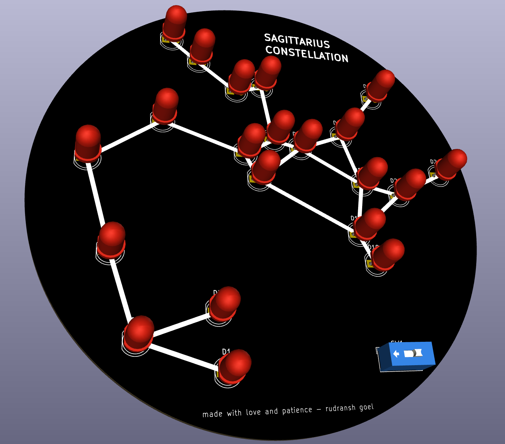

# constellation

### what is it
> it is a constellation pcb of "sagittarius", it includes 21 leds and a coin cell for powering them. it lights up and shows the constellation.

### BOM
|Name                |Quantity|Price (USD)|Link                                                                        |
|--------------------|--------|-----------|----------------------------------------------------------------------------|
|LEDs                |21      |0          |SELF SOURCED                                                                |
|Coin Cell           |1       |0          |SELF SOURCED                                                                |
|Coin Cell Holder SMD|1       |0.52       |https://www.digikey.com/en/products/detail/keystone-electronics/3034/4499289|
|PCB                 |5       |9.38       |https://jlcpcb.com/                                                         |
|                    |        |           |                                                                            |
|                    |        |9.9        |                                                                            |

Final cost is around $9.9